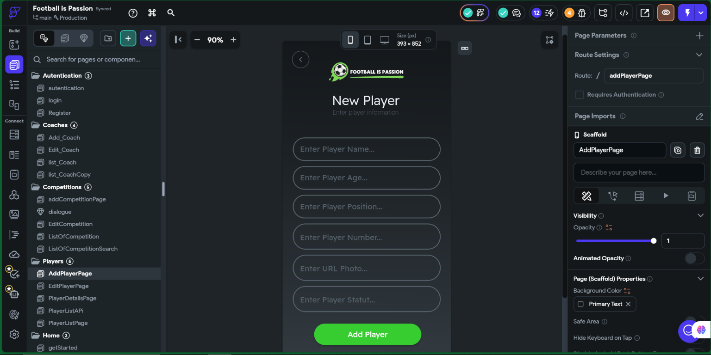
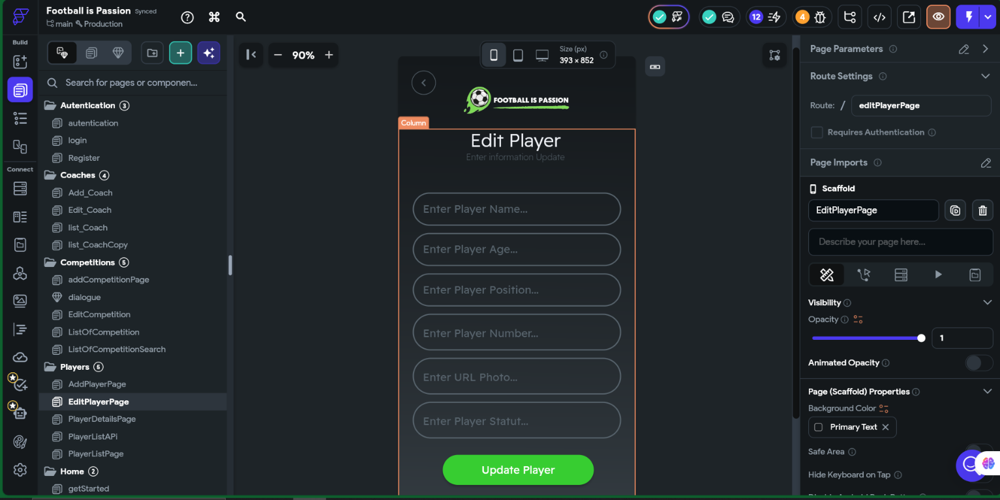
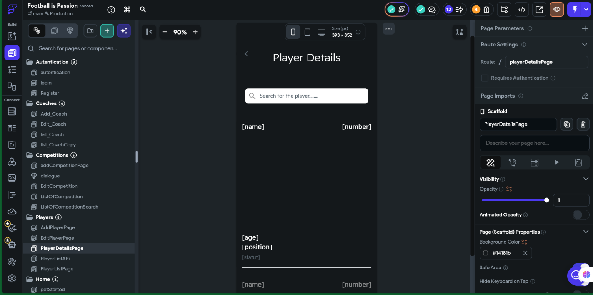
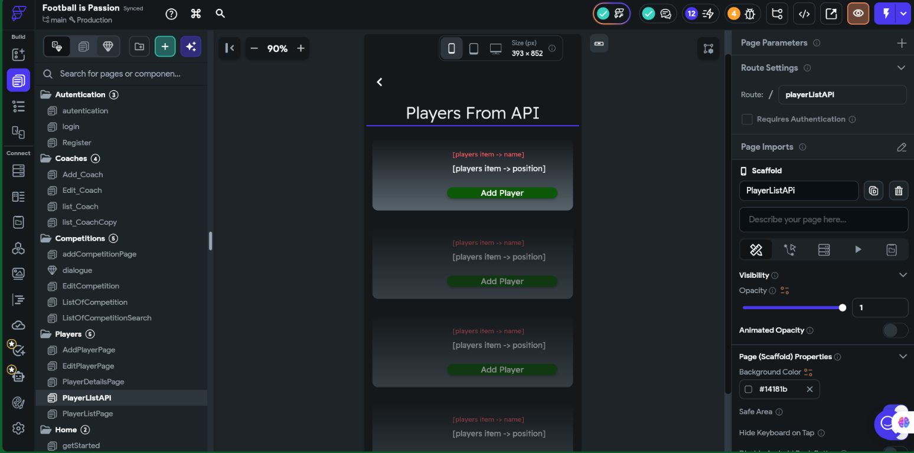
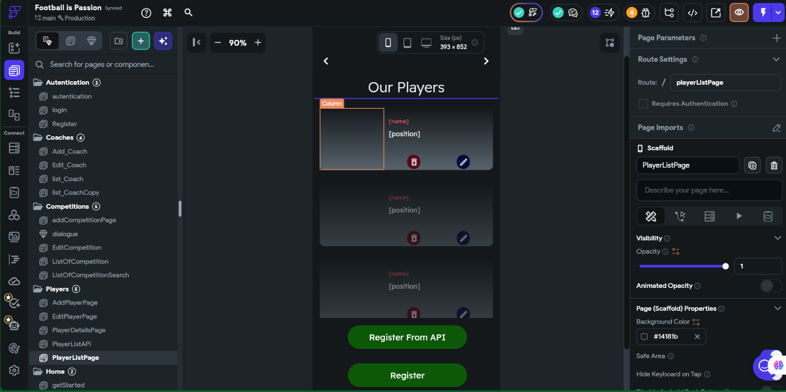

# Football is Passion — Application FlutterFlow

Projet de groupe réalisé avec FlutterFlow autour de la gestion d’une équipe de football. L’application regroupe plusieurs espaces, notamment l’authentification, les entraîneurs, les compétitions et les joueurs.

## Ma contribution : gestion des joueurs

Ma partie du projet porte sur le module de gestion des joueurs. Les écrans permettent de créer et modifier une fiche joueur, consulter ses informations et parcourir une liste de joueurs. Le module comprend également un écran présentant les joueurs récupérés depuis une API.

Les informations d’un joueur comprennent notamment le nom, l’âge, le poste, le numéro, le statut, la photo et l’identifiant utilisateur.

### Écrans du module

#### Ajouter un joueur

Formulaire de création d’une fiche joueur : nom, âge, poste, numéro, URL de la photo et statut.

#### Modifier un joueur

Formulaire de mise à jour des informations d’un joueur existant.

#### Détails d’un joueur

Écran de consultation des informations associées aux joueurs.

#### Joueurs récupérés depuis l’API

Liste de joueurs affichée depuis l’API REST utilisée dans le projet.

#### Liste des joueurs

Vue de la liste des joueurs avec des actions de modification et de suppression, ainsi que des options d’inscription.

## Données et intégrations

Le dépôt documente une collection Firestore `Players` avec les champs `name`, `age`, `position`, `number`, `statut`, `photo` et `userId`. Il contient aussi des captures de configuration et de test d’une API REST MockAPI pour les joueurs.

## Outils

- FlutterFlow pour la conception des pages et des interactions de l’application.
- Firebase Firestore pour la structure des données documentée dans le projet.
- API REST MockAPI pour l’affichage de joueurs provenant d’une API.

## Travail de groupe

Ce dépôt rassemble le travail réalisé en équipe. Ma responsabilité dans ce projet est le module **Gestion des joueurs** : formulaires d’ajout et de modification, consultation et listes de joueurs.
